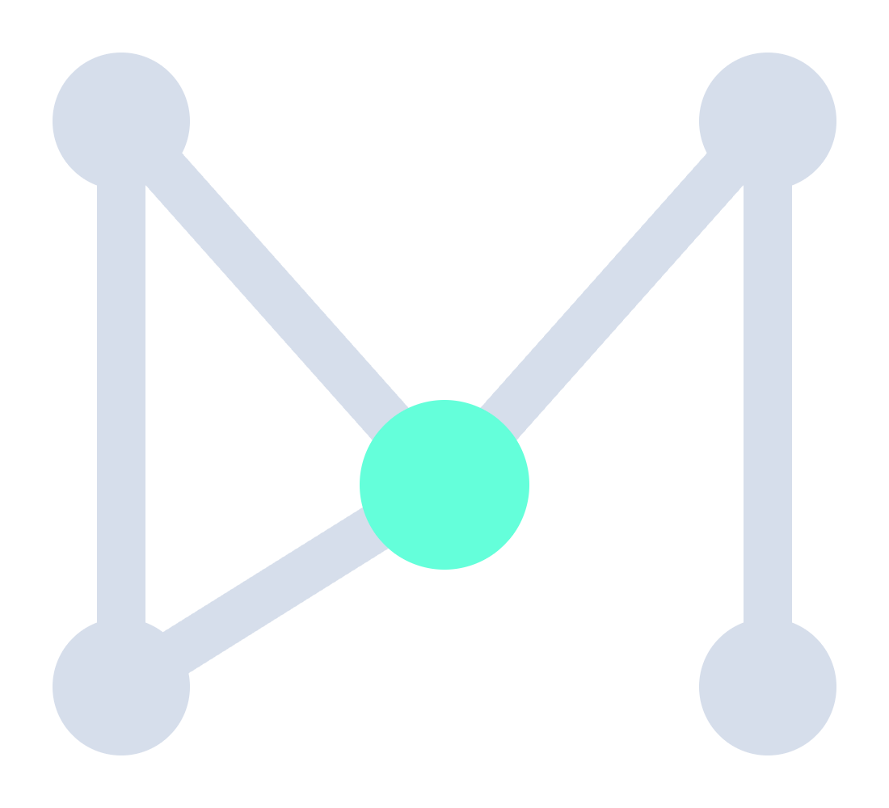
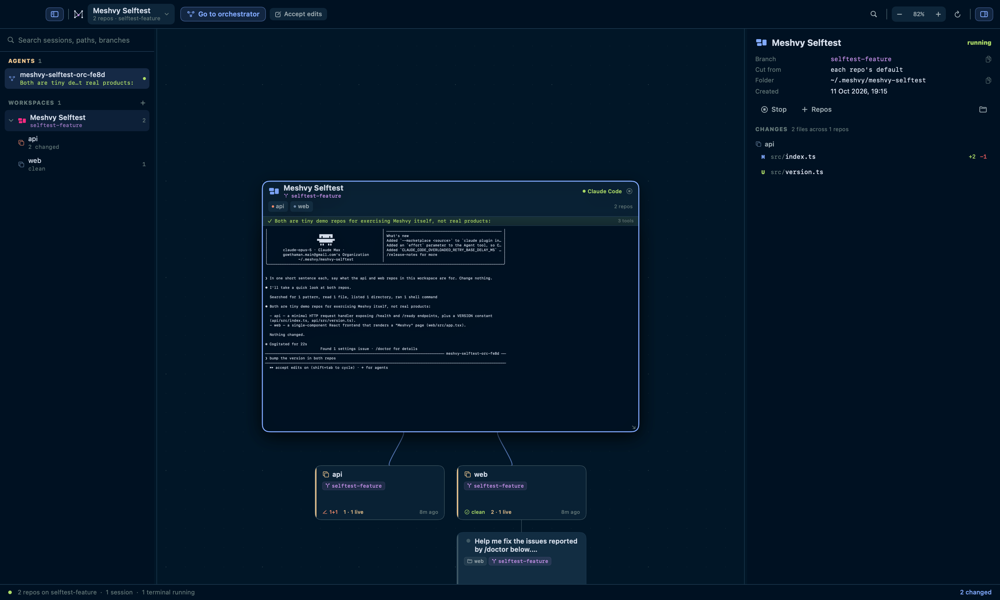
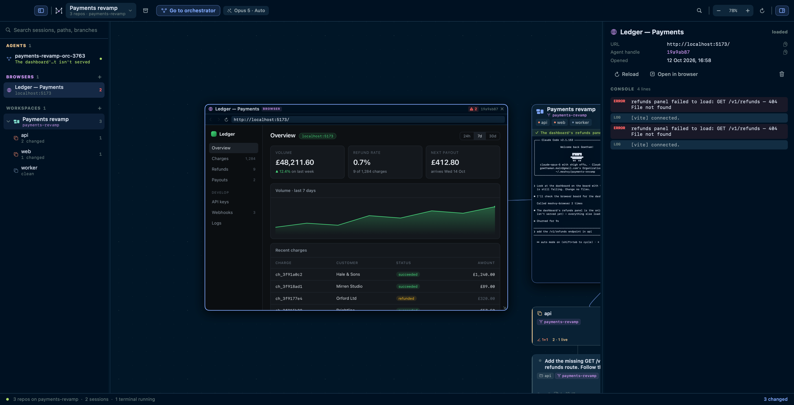
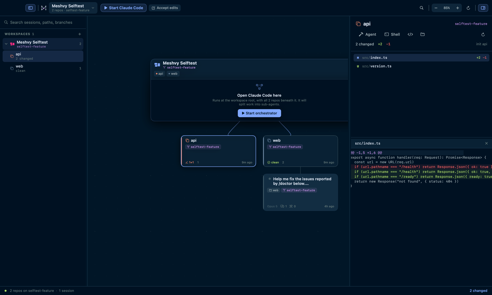
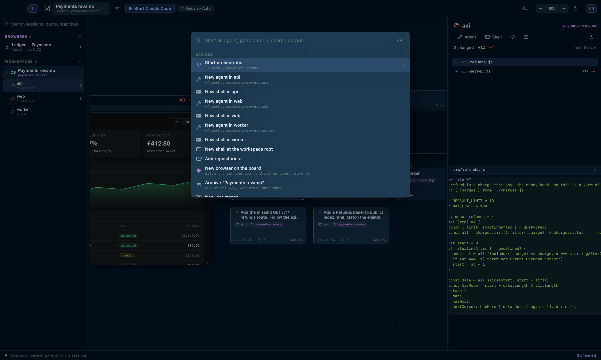
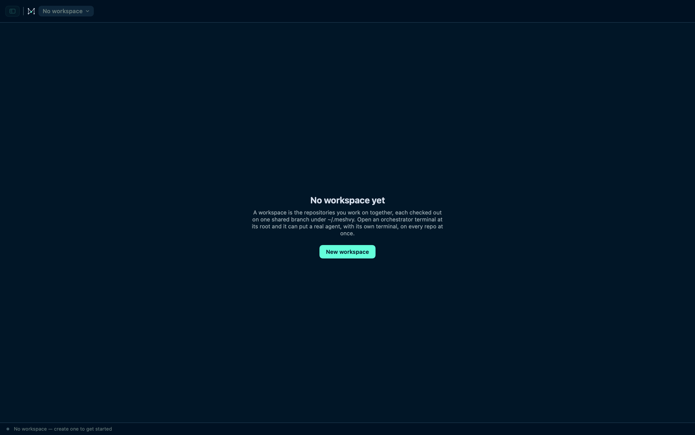

# Meshvy

A native macOS app for running coding agents across several repositories at
once, on an infinite canvas.

Meshvy starts empty. You add the repositories you work on together as a
**workspace**; it cuts one branch across all of them and checks each out side
by side under `~/.meshvy/`. Open Claude Code on the workspace node and every
repository is a subdirectory beneath it, so one orchestrator can put a real
agent — with its own terminal — on each of them.



One workspace across three repositories, the orchestrator delegating an agent
to two of them, and the app they are all changing running on the board beside
them. Every screenshot here is the app drawing itself — see
[Shots](#shots).

## Install

One command, if you have the [`gh` CLI](https://cli.github.com) signed in:

```sh
gh api repos/gowth6m/meshvy/contents/scripts/install.sh --jq .content | base64 -d | bash
```

It downloads the latest release, checks it against the published SHA-256,
installs to `/Applications` and clears the quarantine flag. Run it again to
update, or `PREFIX=~/Applications` to install somewhere else.

Or grab the `.dmg` from
[Releases](https://github.com/gowth6m/meshvy/releases), open it, and drag
Meshvy to Applications. Universal — Apple Silicon and Intel. **macOS 14+.**

Meshvy drives the `claude` CLI rather than the API, so install
[Claude Code](https://claude.com/claude-code) first and sign in.

Releases are signed with a Developer ID and notarised by Apple, so a download
opens without a warning. Check for yourself:

```sh
./scripts/verify-release.sh /Applications/Meshvy.app
```

> **Before 0.10.1** builds were unsigned, and macOS refused the first launch
> with *“Apple could not verify Meshvy is free of malware”*. If you are still
> on one, update — or clear the flag it was downloaded with:
> `xattr -dr com.apple.quarantine /Applications/Meshvy.app`.

Once installed, Meshvy updates itself — see [Updating](#updating).

## Uninstall

**Meshvy → Uninstall Meshvy…**, or run the script that ships inside the app:

```sh
/Applications/Meshvy.app/Contents/Resources/uninstall.sh --dry-run   # look first
/Applications/Meshvy.app/Contents/Resources/uninstall.sh
```

It removes the app, `~/Library/Application Support/Meshvy`, the keychain entry,
and the workspaces under `~/.meshvy`.

The workspaces are the part worth care. They are not ordinary folders — each is
a `git worktree` registered inside your real repository, so deleting them with
`rm` would leave every source repo pointing at a checkout that no longer
exists. The uninstaller hands each one back with `git worktree remove` and
prunes the origin, and **leaves alone any checkout holding uncommitted or
unpushed work**, telling you which and why. Nothing in your own repositories is
touched.

| Flag | |
|---|---|
| `--dry-run` | print the plan, change nothing |
| `--keep-worktrees` | remove the app but leave `~/.meshvy` alone |
| `--force` | also remove checkouts with unsaved work |
| `--yes` | skip the confirmation |

## The model

**Workspace** — one branch, checked out as a `git worktree` in every repository
you picked, all under one folder:

```
~/.meshvy/payments-revamp/
  api/      → repo "api"    on branch payments-revamp
  web/      → repo "web"    on branch payments-revamp
  worker/   → repo "worker" on branch payments-revamp
```

Creating it is one step: name it, pick the repositories, choose the base branch
to cut from. Another branch means another workspace.

**The workspace node** is the parent on the canvas. It names the branch, shows
a chip per repository, and hosts the orchestrator's Claude Code session in its
own body — the working directory *is* that folder. Edges run down to each
repository.

**Delegated agents are real terminals.** When the orchestrator splits work up,
each teammate is a full Claude Code session with its own terminal node you can
read, interrupt and type into. It delegates through a `meshvy` helper that
Meshvy puts on its PATH:

```sh
meshvy spawn <repo> "<task>"   # start an agent there; prints an agent id
meshvy wait <id>               # block until it finishes, print what it reported
meshvy send <id> "<message>"   # type a follow-up into its terminal
meshvy context <id>            # read what another agent has been doing
meshvy status                  # every agent on the board and its state
meshvy list
```

Claude's own Agent tool is deliberately avoided for this: its sub-agents run
*inside* the parent process, with no pid and no pty, so there is nothing a
terminal can attach to and you cannot watch or steer them. If one gets used
anyway it still appears as a card read from the parent's transcript, so no work
is invisible.

**Terminals** come in three kinds — the workspace orchestrator, a per-repo
agent, and a plain shell. Right-click a repository card for the last two.

**Browser nodes** put the running application on the board next to the agents
building it — see [The browser](#the-browser).

**Archiving** a workspace (⌥⌘A, or the box in the toolbar) takes it off the
board and out of the switcher without touching a thing on disk: the worktrees
stay registered in their repositories and the branch stays where it is.
Restore it from **Archived** in the workspace menu or at the foot of the
sidebar. Deleting worktrees is still there, still separate, and still asks.

## The browser

A workspace gives you the repositories and the agents. What those agents are
building is a *running application*, and until there was a browser node the
only way to look at one was to leave Meshvy.

A browser node is a real page on the canvas — **⌘B**, or right-click a
repository and **Open a browser here**. Type `localhost:3000` and watch your
app next to the agent writing it. It keeps cookies between launches, so a dev
server you have signed into stays signed in, and the node reopens where you
left it.



Selecting the node puts the page's console in the inspector, and the header
carries a count of what it has thrown — above, two errors from a panel whose
endpoint does not exist yet, which is what the agent on the right was asked to
go and read.

The point is that an agent can drive the same page. Every session Meshvy
starts is given a `browser_*` tool set over MCP, with no setup from you:

| | |
|---|---|
| `browser_open` | point a node at a URL, opening one if there is not one |
| `browser_snapshot` | the page's text, plus every control with a CSS selector |
| `browser_click` · `browser_type` | act on a selector the snapshot handed back |
| `browser_console` | what the page logged and what it threw |
| `browser_screenshot` | a PNG it can read with the Read tool |
| `browser_eval` · `browser_wait_for` | run JavaScript · wait for text or an element |
| `browser_list` · `browser_navigate` · `browser_reload` · `browser_back` · `browser_close` | |

Typing fires the `input` and `change` events a framework listens for, so React
and Vue forms see it. Agents are told to check the console before claiming a
web change works, and the errors a page throws come back attached to whatever
action caused them.

The engine is WebKit, the same one Safari uses, rather than Chromium — it is
what macOS can host inside a node on the canvas. The short id in the header is
how an agent addresses that node.

## What's on the board

Six kinds of node, with the edges saying how they relate: a repository is
*owned* by its workspace, an agent was *dispatched* by it, a browser *watches*
what they produce.

**The workspace node** hosts the orchestrator's session in its own body and
names every repository under it.

**Worktree cards** come from `git worktree list`: branch, dirty and untracked
counts, divergence from upstream, tip commit.

**Terminal nodes** are the agents and the shells — each a real pty you can
read, interrupt and type into.

**Browser nodes** are the running application, purple so they are findable on a
board of agents.

**Session cards** come from `~/.claude/projects/…`: title, folder, branch,
model, prompts sent, tool calls, context size at the last turn, last activity.
A session already shown by a terminal does not get a second card.

**Sub-agent cards** are whatever an agent dispatched that has no terminal of
its own, read out of the parent's transcript.

**Agent status** comes from the agent itself, not from reading its screen.
Every session Meshvy starts is handed hooks that report what it is doing, so a
node carries a strip under its header with the tool in flight, the permission
it is blocked on, or the first line of what it said when it finished. An agent
that needs you is marked unread — a dot on its header and in the sidebar, a
count on the Dock icon, and a notification if you turn them on. `⌥⌘N` walks you
through whoever is waiting.

## Changes

Select a repository to see every file it has touched against HEAD — modified,
added, deleted, renamed, untracked — with per-file `+/−` counts and a unified
diff showing both line numbers. Select the workspace node instead and you get
the same list across every repository at once, which is the view you want after
an orchestrator run.



## ⌘K

One box for starting an agent in any repository, switching workspace, jumping
to a node by name, branch or path, and changing the permission mode. With three
characters or more it also searches *inside* your live terminals and shows the
line it matched — the one thing the canvas cannot tell you.



## Using it

| | |
|---|---|
| Command palette | ⌘K |
| New workspace | ⇧⌘N |
| Add repositories | ⇧⌘O |
| Start / focus orchestrator | ⇧⌘T |
| Shell at the workspace root | ⌘T |
| New browser | ⌘B |
| Archive the workspace | ⌥⌘A |
| Next agent waiting on you | ⌥⌘N |
| Find | ⌘F · frame the hits ⇧⌘F |
| Fit to content | ⌘0 · actual size ⌘1 · zoom ⌘+ / ⌘− |
| Toggle sidebar / inspector | ⌥⌘S / ⌥⌘I |
| Refresh everything | ⌘R · git only ⇧⌘R |
| Keyboard shortcuts | ⌘/ |

Pan by dragging empty canvas or scrolling; zoom with ⌘-scroll or a pinch.
Resting the pointer on a terminal or a browser for half a second hands it the
wheel, so a scrollback is reachable and a page can be scrolled — zoom stays the
canvas's. Drag any node by its title bar, resize from the corner grip,
double-click one to centre it, and drag the side panels from their inner edge.
Scrolling follows the system "natural scrolling" preference;
**View → Invert Scroll Direction** if you want the opposite.

Cards thin out as you zoom out rather than turning to mush: below 62% they keep
a title and a status line, and below 30% they are a coloured block. A terminal
and a browser stop drawing their contents at half scale and say where they are
pointed instead — neither is interrupted, both come straight back.

**Model, effort and permission mode** sit in one menu, on the pill in the
toolbar and on every agent card. Whatever you pick is what the next agent
starts with, and it is remembered for next time. On a card it also retunes that
session where the CLI allows it: `/model` and `/effort` take effect straight
away, while the permission mode is fixed at launch — ⇧⇥ cycles it inside the
session, or restart the agent from the same menu.

A fresh install opens on this, and so does a board whose last workspace you
archived:



### First run in a new workspace

Claude Code asks you to trust a folder it has not seen, so the first
orchestrator in a workspace shows its trust prompt — press Enter. Meshvy
deliberately does not pre-answer it: that would mean writing to
`~/.claude.json`, which every running Claude Code also writes, and a
read-modify-write there could clobber their changes.

## Updating

Meshvy checks GitHub Releases on launch. When a newer version exists a pill
appears in the toolbar; it shows the release notes and **Install and restart**,
which downloads the zip, checks it against the published SHA-256, validates the
bundle and swaps itself. Also **Meshvy → Check for Updates…**

The repository is private, so both the listing and the asset download need a
token. Meshvy asks the `gh` CLI you are already signed in to
(`gh auth token`), or uses `GITHUB_TOKEN`. A public repository needs neither —
same code path. Development builds never offer updates.

A running bundle cannot replace itself, so a detached helper waits for Meshvy
to quit, swaps the two, clears the quarantine flag and relaunches. If the swap
fails it puts the old bundle back, so a failed update never leaves you with
nothing installed.

## Build

Requires macOS 14+ and a Swift 6 toolchain. **Xcode is not needed** — the Swift
compiler and macOS SDK from the Command Line Tools are enough:

```sh
xcode-select --install     # if you don't already have the tools
./scripts/build-app.sh     # -> dist/Meshvy.app
open dist/Meshvy.app
```

`build-app.sh` produces a universal binary by cross-compiling each slice and
`lipo`-ing them together — SwiftPM's own `--arch a --arch b` needs Xcode's
`xcbuild`, which the Command Line Tools do not ship. `UNIVERSAL=0` gives a
faster native-only build while developing.

The only dependency is [SwiftTerm](https://github.com/migueldeicaza/SwiftTerm)
for the terminal emulator. Brand assets are in `Resources/brand/`;
`./scripts/make-icon.sh` rebuilds the icon from `app-icon.png`, scaling it onto
Apple's grid so it sits at the same size as other Dock icons. The toolbar mark
is drawn in SwiftUI from the same geometry as `mark-on-dark.svg`, in the same
colours — Night Owl's foreground with the brand mint `#64FFDA` on the lit node,
which is also the app's accent. `app-icon-mint.png` is the inverse of the
shipped icon, mint ground and dark mark, for use on dark backgrounds.

## Releasing

`VERSION` is the source of truth. Write the notes in `CHANGELOG.md` under a
matching `## [x.y.z]` heading, then:

```sh
./scripts/release.sh 0.9.0
git push origin HEAD && git push origin v0.9.0
```

The tag triggers `.github/workflows/release.yml`, which builds a universal app,
packages a DMG and a zip with checksums, and publishes a GitHub Release.
`release.sh` refuses to tag on a dirty tree, an existing tag, or a missing
changelog section. `ci.yml` builds every push and fails on warnings in
`Sources/Meshvy`.

To build artifacts locally without tagging: `./scripts/package-release.sh`.

### Signing and notarisation

Releases are signed and notarised; `scripts/verify-release.sh` says whether a
given build really is, and the release workflow runs it as a gate rather than
trusting that the secrets were set. The six secrets, how to issue a new
certificate or notarisation key without Xcode, and what expires when are in
[docs/signing.md](docs/signing.md).

The workflow still skips cleanly when the secrets are absent — a fork builds
an unsigned release, and its notes say so.

## How it stays fast

Session metadata comes from a byte scan, not a JSON decode: the indexer
memory-maps each transcript and matches literal needles like
`"type":"assistant"` per line, decoding only the few lines whose contents it
needs. A cold index of 412 MB across 145 files takes about **0.35 s**, cached by
size and mtime; a file that has grown is re-scanned from its last complete
record.

Opening a session decodes only the tail of its transcript — 24 MB, back from
the end. Most are smaller and read whole; the pathological ones took **265 ms**
before the panel could draw and now take **62 ms** whatever the length.

Terminals are owned by `TerminalRegistry`, not by the view that shows them —
SwiftUI rebuilds node views on every pan and zoom, and creating the emulator in
`makeNSView` would kill and restart the shell each time.

Geometry and type zoom on different curves. Cards scale with the canvas; type
follows `sqrt(zoom)` clamped to 0.8–1.3, because scaled linearly a title is 5pt
at 45% and shouts at 160%. Terminals magnify rather than reflow: the
container's coordinate system is scaled and the terminal's own frame left
alone, so the grid holds and a running program is not redrawn on every zoom
step.

## Layout

```
Sources/Meshvy/
  App/        entry point, menus, snapshot + test harnesses
  Core/       canvas geometry, Night Owl theme, persistence
  Model/      workspaces, terminals, browsers, sub-agents, sessions, git, diffs
  Services/   byte scanner, indexer, transcript loader, git, worktree builder,
              terminal registry, browser engine + bridge, agent bridge,
              agent hooks, model catalog, updater, FSEvents
  Store/      app state, board composition
  UI/         canvas, workspace node, cards, terminals, browsers, sidebar,
              inspector, diff viewer, command palette, transcript reader
```

### Development harnesses

```sh
Meshvy --snapshot out.png                    # see Shots below for the flags
Meshvy --selftest <repoA> <repoB> [--keep] [--name N] [--branch B]
Meshvy --bridgetest <repo>                   # spawn an agent through the bridge, no LLM
Meshvy --browsertest [--keep]                # a real page, the MCP server, and the app
Meshvy --hooktest [--keep]                   # the hook events a session reports
Meshvy --launchtest                          # live orchestrator that delegates
Meshvy --zoomtest                            # terminal magnifies without reflowing
Meshvy --difftest <worktree>                 # change list and a parsed diff
Meshvy --formattest                          # an older board still decodes
Meshvy --chrometest [--shots <dir>]          # the toolbar's traffic-light gutter
Meshvy --chromeprobe <dir>                   # the same, in real full screen
Meshvy --updatetest [--install]              # the updater against the real release
Meshvy --perftest                            # transcript loading on your largest session
```

`--chromeprobe` has to be launched through LaunchServices
(`open -a Meshvy --args --chromeprobe /tmp/probe`): macOS will not keep a
window full screen for an app that is not frontmost.

### Shots

```sh
./scripts/make-shots.sh                      # every image in docs/
./scripts/make-shots.sh board browser        # or just these
```

`--snapshot` renders the real view tree with no window, so the app can draw
itself from a terminal. `ImageRenderer` cannot draw `ScrollView` content,
AppKit controls, an embedded terminal or a `WKWebView`, so each of those has a
static twin behind the `meshvySnapshotMode` environment flag: a terminal draws
its real screen buffer as text, and a browser draws a still of its real page,
captured in an offscreen window just before the render.

| | |
|---|---|
| `--width` · `--height` | the window to render, in points; the PNG is 2× |
| `--zoom 0.8` | fixed scale on the selection, instead of fitting the board |
| `--browser <url>` | put a browser node on the board, pointed there |
| `--orchestrator "<task>"` | start an agent, give it this, and wait for the turn to end |
| `--select workspace\|browser\|repo` | what the inspector should be showing |
| `--tidy` | hand the free terminals and browsers back to the layout first |
| `--palette` · `--shortcuts` | the overlays that only exist on a keystroke |
| `--agent` | wait for the first hook event before rendering |
| `--wait 6` · `--no-fit` | how long to let the board settle · leave the camera alone |

`make-shots.sh` builds the board the images are taken against rather than using
whatever is on your machine: three throwaway repositories from `docs/demo/`,
one workspace cut across them, a dev server for the web one, and a real
orchestrator run that delegates an agent to two of them. It puts everything
back afterwards — the worktrees, the scratch repos, and its own entry in your
board. The agents are real, so a full run costs what the agents cost.

## What Meshvy does not do

It never pushes, merges or rewrites history. Inspection is read-only and runs
with `GIT_OPTIONAL_LOCKS=0`, so looking at a tree never contends with an agent
working in it. The only git commands that write are `worktree add` and
`worktree remove`, both of which you ask for explicitly. Closing a workspace
keeps its checkouts unless you choose to delete them.

## Licence

Source-available, not open source — see [LICENSE](LICENSE). You may run Meshvy
and fork or modify it for your own use, including at work. You may not
redistribute it or a derivative, or offer it to others as a service.
Gowtham Ravindrathas retains ownership; contributions are assigned to him.

The terminal emulator, [SwiftTerm](https://github.com/migueldeicaza/SwiftTerm),
is MIT-licensed by its own authors.
